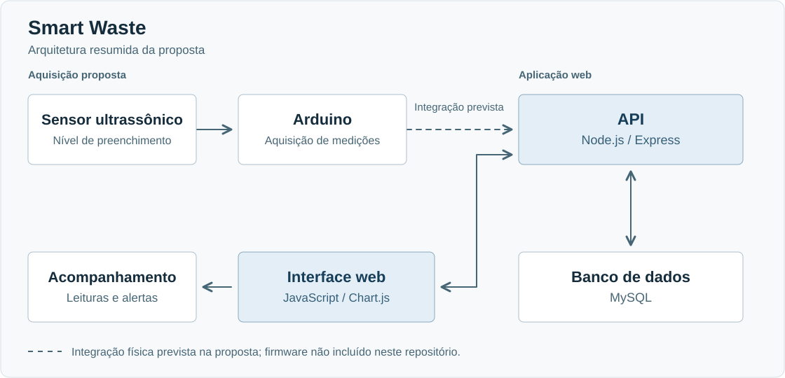

# Smart Waste Systems

Monitoramento do volume de resíduos hospitalares com uma aplicação web para acompanhar recipientes, consultar o histórico de leituras e visualizar alertas.

Projeto Integrador desenvolvido em equipe na **São Paulo Tech School — SPTech**, aproximando desenvolvimento web, banco de dados e a proposta de aquisição de medições com Arduino e sensor ultrassônico.

## Sobre o projeto

O Smart Waste parte de uma pergunta: **como acompanhar o preenchimento dos recipientes para apoiar a decisão de solicitar a coleta?**

A proposta reúne informações de volume em um dashboard, permitindo consultar a situação dos recipientes e observar a evolução das leituras. O projeto tem contexto acadêmico; eficiência operacional, redução de custos e prevenção de transbordamentos são objetivos da solução, sem resultados de implantação hospitalar medidos neste repositório.

## Objetivo e escopo

- Acompanhar o nível de preenchimento dos recipientes.
- Relacionar as leituras às lixeiras e aos tipos de resíduo cadastrados.
- Apresentar indicadores, histórico e estados de atenção no painel.
- Registrar e consultar alertas associados às leituras.
- Apoiar a consulta das informações pelos responsáveis.

A **classificação dos resíduos é manual**. O sensor proposto observa o nível de preenchimento; ele não identifica automaticamente o material descartado. Coleta, transporte, destinação final e integração com empresas responsáveis por essas atividades ficam fora do escopo.

## Funcionalidades

| Área          | Recursos presentes na aplicação                                                  |
| ------------- | -------------------------------------------------------------------------------- |
| Acesso        | Cadastro e autenticação de usuários, com vínculo ao hospital.                    |
| Hospitais     | Rotas para cadastro e consulta de hospitais.                                     |
| Dashboard     | Indicadores e listagem de recipientes, com filtros por tipo e estado de atenção. |
| Histórico     | Consulta das leituras e seleção de lixeira para apresentação no gráfico.         |
| Gráficos      | Visualização dos registros com Chart.js e filtro por tipo de resíduo.            |
| Alertas       | Registro, contagem e apresentação de ocorrências relacionadas às leituras.       |
| Calculadora   | Simulação financeira acadêmica com hipóteses definidas no código.                |
| Suporte       | Interface BobIA integrada à rota de perguntas e ao SDK Google GenAI.             |
| Institucional | Apresentação da proposta, serviços e equipe.                                     |

Os valores da calculadora e as faixas exibidas no dashboard representam as regras do protótipo. Eles não constituem preços comerciais, economia comprovada ou orientação normativa para operação hospitalar.

## Arquitetura



O diagrama resume a proposta do projeto. **Este repositório concentra a aplicação web**; não inclui firmware Arduino ou uma rotina de ingestão física que permita validar, por si só, o caminho completo do sensor até o banco.

Na aplicação, as rotas encaminham as requisições aos controladores, que utilizam os modelos para consultar ou atualizar o MySQL. O JavaScript da interface consome essas respostas para montar os cartões, os gráficos e os indicadores.

## Tecnologias

| Camada            | Tecnologias                   |
| ----------------- | ----------------------------- |
| Interface         | HTML, CSS e JavaScript        |
| Visualização      | Chart.js                      |
| Servidor          | Node.js e Express             |
| Banco de dados    | MySQL e mysql2                |
| Configuração      | dotenv e CORS                 |
| Suporte com IA    | SDK `@google/genai`           |
| Desenvolvimento   | Git, GitHub e nodemon         |
| Hardware proposto | Arduino e sensor ultrassônico |

## Estrutura do repositório

```text
Back-End-Grupo/
├── app.js                     # Inicialização, arquivos estáticos e rotas
├── package.json               # Dependências e comandos npm
├── public/
│   ├── index.html             # Página institucional
│   ├── login.html
│   ├── cadastro.html
│   ├── dashboard.html
│   ├── suporte.html
│   ├── v1calculadora.html
│   ├── css/
│   ├── js/
│   └── imgs/
├── src/
│   ├── routes/                # Rotas de usuários, hospitais e dashboard
│   ├── controllers/           # Tratamento das requisições
│   ├── models/                # Consultas e operações no banco
│   └── database/
│       └── config.js          # Configuração da conexão MySQL
├── LICENSE
├── SMART-WASTE-ARQUITETURA.svg # Diagrama estático utilizado neste README
└── README.md
```

## Executar localmente

### 1. Preparar o ambiente

Tenha instalados:

- **Node.js**, preferencialmente versão 22 ou superior, e npm.
- **MySQL 8 ou superior**, pois as consultas utilizam funções de janela como `ROW_NUMBER()`.
- **Git**, para clonar o projeto.

```sh
git clone https://github.com/Smart-Waste-Monitor/Back-End-Grupo.git
cd Back-End-Grupo
npm install
```

O repositório não possui um arquivo de lock versionado. Use `npm install`; as versões efetivamente instaladas seguem os intervalos do `package.json`.

### 2. Preparar o banco de dados

Obtenha com a equipe o esquema e os dados de exemplo compatíveis com a aplicação. **O repositório atual não inclui um script SQL de criação e carga inicial.**

Os modelos referenciam, entre outras, estas tabelas:

```text
hospital
usuario
tipoResiduo
lixeira
leitura
alerta
```

O dashboard também utiliza as views `vw_atualVolumes` e `vw_geralVolumes`. O modelo do dashboard contém rotinas de criação e recriação dessas views; o usuário do banco precisa das permissões correspondentes.

Prepare os registros de hospital e os dados necessários ao vínculo dos usuários, aos recipientes e às leituras. Criar apenas um banco vazio não é suficiente para utilizar os fluxos da aplicação.

### 3. Configurar as variáveis de ambiente

Crie um arquivo **`.env.dev`** na raiz do repositório:

```dotenv
AMBIENTE_PROCESSO=desenvolvimento

APP_HOST=localhost
APP_PORT=3000

DB_HOST=localhost
DB_PORT=3306
DB_DATABASE=smart_waste
DB_USER=seu_usuario
DB_PASSWORD=sua_senha

# Configure uma chave válida para utilizar o suporte com IA:
# MINHA_CHAVE=sua_chave_da_api_gemini
```

Os valores acima são exemplos. Ajuste o banco, o usuário e a senha conforme o ambiente preparado no passo anterior. Mantenha arquivos com credenciais fora do versionamento.

Na configuração atual, a variável local `ambiente_processo` em `app.js` seleciona `.env.dev` para desenvolvimento e `.env` para produção. A variável `AMBIENTE_PROCESSO`, lida pelo módulo de banco, também deve estar definida com um desses valores.

O cliente Google GenAI é instanciado durante a inicialização do servidor. A funcionalidade de suporte utiliza `MINHA_CHAVE`; uma chave válida é necessária para obter respostas da rota `/perguntar`.

### 4. Iniciar a aplicação

```sh
npm start
```

Para reiniciar automaticamente o servidor após alterações:

```sh
npm run dev
```

Com a porta do exemplo, abra **http://localhost:3000**.

| Página        | Endereço              |
| ------------- | --------------------- |
| Institucional | `/`                   |
| Login         | `/login.html`         |
| Cadastro      | `/cadastro.html`      |
| Dashboard     | `/dashboard.html`     |
| Calculadora   | `/v1calculadora.html` |
| Suporte       | `/suporte.html`       |

Realize o cadastro com um hospital válido e utilize o login para acessar o fluxo do painel. Os dados apresentados dependem do banco configurado e das leituras disponíveis.

## Principais rotas da aplicação

| Método | Rota                     | Finalidade                                             |
| ------ | ------------------------ | ------------------------------------------------------ |
| POST   | `/usuarios/cadastrar`    | Cadastrar usuário.                                     |
| POST   | `/usuarios/autenticar`   | Autenticar usuário.                                    |
| POST   | `/hospital/cadastrar`    | Cadastrar hospital.                                    |
| GET    | `/hospital/listar`       | Consultar hospitais cadastrados.                       |
| POST   | `/dash/lixeirasGerais`   | Consultar a situação dos recipientes.                  |
| POST   | `/dash/lixeirasAlertas`  | Consultar recipientes na faixa de alerta do protótipo. |
| POST   | `/dash/lixeirasCriticas` | Consultar recipientes na faixa crítica do protótipo.   |
| POST   | `/dash/graficoEspec`     | Consultar o histórico usado no gráfico.                |
| POST   | `/dash/graficoFiltrado`  | Consultar dados filtrados por tipo de resíduo.         |
| POST   | `/dash/alertasCadastro`  | Registrar alerta associado a uma leitura.              |
| POST   | `/dash/consultaAlertado` | Consultar a contagem de alertas.                       |
| POST   | `/perguntar`             | Enviar pergunta ao suporte com IA.                     |

Os formatos dos corpos das requisições e das respostas podem ser consultados em `src/routes/`, `src/controllers/` e nos arquivos JavaScript de `public/js/`.

## Estado do projeto e evolução

O Smart Waste foi desenvolvido em ambiente acadêmico. A presença das interfaces e das rotas não comprova implantação hospitalar, atualização contínua das leituras, precisão física ou impacto operacional medido.

## Equipe

- Guilherme Silva Domingues
- Heloisa de Almeida Oliveira
- Julia Ayumi Yamasaki
- Kristhian Fortunato Wirthl
- Letícia dos Santos Alves
- Matheus Maceu Ferreira da Silva

O projeto é resultado de trabalho coletivo. Entre as contribuições de Matheus estão a integração do dashboard com a API e o MySQL, consultas de histórico, filtros, gráficos e rotinas de alertas. Ele também atuou como revisor do código dos colegas da equipe. Esses exemplos representam parte de sua participação.

As alterações e a colaboração dos integrantes podem ser consultadas no [histórico do repositório](https://github.com/Smart-Waste-Monitor/Back-End-Grupo/commits/main/).

## Base do projeto e licença

A aplicação utiliza como base o **Web Data Viz**, projeto educacional da BandTec Digital School, atual São Paulo Tech School. O `package.json` preserva o nome dessa base.

O repositório inclui a [licença MIT](LICENSE), com os créditos originais da instituição. Preserve o arquivo de licença e seus avisos ao reutilizar o código.
